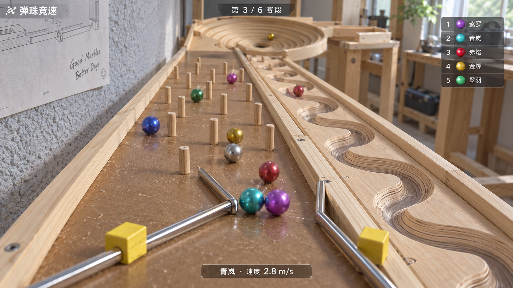

# 弹珠竞速 · 工坊试跑

八颗弹珠在随机生成的三维木质赛道上竞速的网页原型：真实刚体物理、实时排名、文字与语音解说、模拟观众弹幕、本地押注，以及每场随机播放的背景音乐。

技术栈：Vite 7 + three.js（渲染）+ Rapier（物理，1/360 秒步长）。

**在线演示**：<http://8.130.45.145:4180/>

> 该地址服务的是已部署的 `dist/` 静态构建，未必包含最新源码改动；要看当前代码效果请按下方「快速开始」在本地运行。



---

## 快速开始

环境要求：Node.js `^20.19.0` 或 `>=22.12.0`；浏览器需支持 WebAssembly、顶层 await 与 ES2022（Chrome / Edge / Firefox / Safari 近两年版本均可）。首次使用先在本目录执行 `npm install`。

### 方式 A：一键启动（推荐）

双击 `start-or-restart.cmd`，脚本会依次：构建最新源码 → 若已有本项目的预览进程则先停止 → 后台启动 `vite preview` → 轮询直到首页返回 200 → 打印地址。

```powershell
powershell -NoProfile -ExecutionPolicy Bypass -File tools/start-or-restart.ps1
```

- 访问或刷新 <http://127.0.0.1:4180/>
- 运行状态在 `.run/preview.json`，日志在 `.run/preview.log` 与 `.run/preview-error.log`
- 构建失败时不会停掉正在运行的旧版本
- 端口被其他程序占用时只提示、不会误杀别人的 Node 进程
- **注意**：该方式服务的是 `dist/` 静态构建，改完源码要再跑一次脚本才生效

### 方式 B：开发模式（热更新）

```sh
npm install
npm run dev
```

打开 <http://127.0.0.1:4180/>，改 `src/` 下的文件会热更新。端口使用 strictPort，4180 被上面的 preview 占用时需先停掉它（Ctrl+C 或再跑一次方式 A）。

> 提示：若页面看起来还是旧代码，先确认是哪种服务。`npm run dev` 支持热更新，`npm run preview` 与 `start-or-restart.cmd` 读的是 `dist/`，必须重新构建。

### 方式 C：手动构建与预览

```sh
npm run build     # 产物写入 dist/
npm run preview   # 预览 dist/，同样占用 4180
```

背景音乐不入库：把 `.ogg` 放进 `src/static/music/` 就会被自动收录（无需改代码），目录为空时只是没有背景音乐。

---

## 玩法与操作

1. 左侧「冠军押注」里选 1–4 颗弹珠，点「开始比赛」。
2. 倒计时结束弹珠落坡，实时排名、解说和弹幕同时开始。
3. 「再赛一场」会重新生成赛道并回到押注界面。

| 操作 | 说明 |
| --- | --- |
| `空格` | 开始比赛 / 暂停 / 继续 |
| `数字键 1–8` | 切换关注的弹珠（也可点左下角卡片选择） |
| 拖动、滚轮 | 进入自由镜头，自动跟拍停止 |
| 点镜头按钮 | 恢复自动跟拍（含导播镜头） |
| 悬停弹幕 | 该条弹幕暂停移动，移开继续 |
| 右上「设置」 | 音乐、音效、语音、弹幕、音量、解说音色与语速 |

### 押注规则

- 本地账户初始 **1000 珠**，每天可领 **100 珠**（按本机日期判断，刷新不清零）
- 无入场费，每选一颗弹珠 **5 珠**，最多选 4 颗
- 押中冠军：`5 × 8 球 × 0.95 = 38 珠`（含 5% 抽水），选几颗都不会让奖励翻倍
- 比赛中刷新、关页面或点「新一场」视为中断，已付珠子不退
- 这是纯本地单机积分，没有服务端账户，也没有联机对手

---

## 多语言

界面、弹幕、解说、赛段名和选手名都支持 **简体中文 / English / Русский / Français / 日本語** 五种语言。

- **自动选择**：首次访问按访问者 IP 所在地区匹配语言（俄语区 → `ru`，法语区 → `fr`，日本 → `ja`，中港澳台新 → `zh-CN`，其余 → `en`）；地区查询失败时回退浏览器语言。
- **手动切换**：右上「设置」→「语言」。选「跟随网络（自动）」会在每次加载时重新按地区判断，选具体语言则记住该选择。
- **URL 覆盖**：`?lang=en`、`?lang=ru`、`?lang=fr`、`?lang=ja`、`?lang=zh-CN`，方便分享和测试。
- 语言偏好存于 `marble-race-locale-v1`；地区查询结果在 `sessionStorage` 缓存 6 小时，避免每次加载都请求。
- 地区查询走公共接口（`ipapi.co` → `ipwho.is` → `api.country.is`，任一成功即止，1.6 秒超时）。内网或离线环境下会直接使用浏览器语言，不影响游戏。
- 语料规模：中文弹幕 799 条，其他语言各 154–168 条（11 类）；实时解说 37 类事件、30 段赛段描写与 12 个关键赛段点评为全量翻译。

---

## 本地存储

全部设置只存在当前浏览器，清站点数据即恢复默认。

| localStorage 键 | 内容 |
| --- | --- |
| `marble-race-wallet-v2` | 珠数、当前押注、每日领取日期 |
| `marble-race-media-settings-v1` | 音乐/音效开关、音乐音量 |
| `marble-race-voice-settings-v1` | 解说音色与语速 |
| `marble-race-danmaku-v1` | 弹幕总开关 |
| `marble-race-danmaku-settings-v1` | 弹幕基础条数与速度倍率 |
| `marble-race-locale-v1` | 语言选择（具体语言码，或 `auto` 表示跟随网络） |
